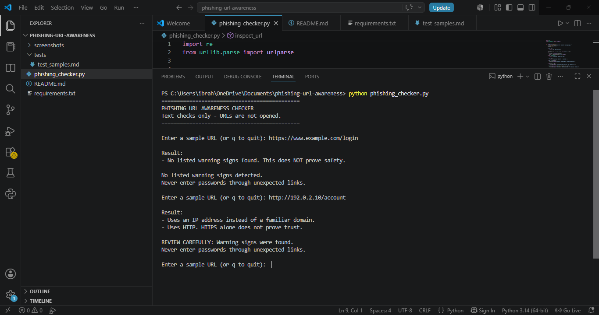
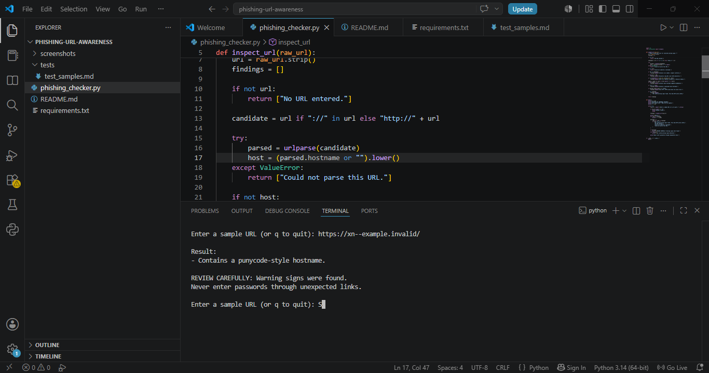

Phishing URL Awareness Checker

1. Project Overview

The Phishing URL Awareness Checker is a beginner-friendly Python command-line project that examines visible URL text for selected warning signs commonly associated with suspicious links.

The program does not open URLs, visit websites, or send URL data to external services.

2. Features

The checker looks for the following warning signs:

- The URL contains an "@" symbol.
- The URL is longer than 100 characters.
- The hostname looks like an IPv4 address.
- The hostname contains five or more segments.
- The hostname contains the "xn--" punycode marker.
- The URL uses HTTP instead of HTTPS.

It also provides a warning summary, accepts multiple URLs in one session, allows the user to quit by entering "q", and handles certain malformed URLs.

3. Technologies Used

- Python 3.10 or later
- Python built-in "re" module
- Python built-in "urllib.parse" module
- Visual Studio Code

4. Project Structure

phishing-url-awareness/
├── phishing_checker.py
├── README.md
├── requirements.txt
├── tests/
│   └── test_samples.md
└── screenshots/
    ├── sample_run.png
    └── test_results.png

5. Requirements

Install Python 3.10 or later and Visual Studio Code.

No additional Python packages are required.

6. How to Run

1. Open the project folder in Visual Studio Code.
2. Open "phishing_checker.py".
3. Run the file using Run Without Debugging or "Ctrl + F5".
4. Enter a sample URL when prompted.
5. Enter "q" to exit the program.

7. Sample Output

PHISHING URL AWARENESS CHECKER
Text checks only. URLs are never opened.
Enter q to quit.

Enter a sample URL: http://192.0.2.10/account

Result:
- Uses an IP address instead of a familiar domain.
- Uses HTTP. HTTPS alone does not prove trust.

REVIEW CAREFULLY: Warning signs were detected.
Remember: this tool cannot prove a URL is safe.

8. Testing

The test cases and their results are documented in "tests/test_samples.md".

The tests cover a normal example URL, an IP address with HTTP, an "@" symbol, many hostname segments, and a punycode marker.

### Sample Run — IP Address and HTTP Warnings

### Test Results — Punycode Warning

9. Improvements Implemented

Repeated URL checking

The program accepts multiple URLs in one session until the user enters "q".

Warning summary

When the checker detects listed warning signs, it displays a "REVIEW CAREFULLY" message.

Malformed URL handling

The program catches certain parsing errors and displays an explanatory message instead of stopping unexpectedly.

Improved formatting

Headings, separators, and readable result messages make the output easier to understand.

10. Limitations

- This is an awareness tool, not a definitive phishing detector.
- A URL with no listed warning signs can still be malicious.
- HTTPS does not guarantee that a website is trustworthy.
- The checker examines visible URL text only.
- It does not visit websites or verify their reputation.

11. Ethical Use

Use this project for educational purposes and authorized testing. Do not enter passwords or other sensitive information into unexpected links. The example URLs are intended for safe testing.

12. Author

Name: [IBRAHIM NAZIR]

Project: Phishing URL Awareness Checker
